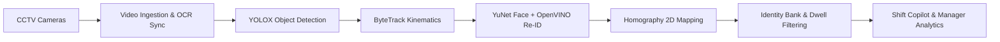

<div align="center">

# 🍽️ ServiceFlow Vision
### Autonomous Computer Vision & Multi-Camera Floor Operations Copilot

[](https://www.python.org/)
[](https://openvino.ai/)
[](#)
[](#-privacy--compliance)
[](LICENSE)

*Turning passive ceiling CCTV cameras into an intelligent, real-time operational copilot for high-turnover hospitality venues.*

[Key Features](#-key-features) • [Architecture](#-architecture--pipeline) • [Quickstart](#-quickstart) • [Application Modules](#-application-modules) • [Privacy & Compliance](#-privacy--compliance) • [Roadmap](#-roadmap)

---

</div>

## 📌 Executive Summary

High-volume restaurants in major hospitality hubs (Dubai, Abu Dhabi, Riyadh) lose **10% to 15% of table turnover capacity** to physical floor friction:
* **First-Service Greeting Delays:** Unmonitored delays exceeding 3–5 minutes lower customer satisfaction and review ratings.
* **Turnaround Bottlenecks:** Finished tables sit unbussed and unseated for 8–15 minutes during peak rushes.
* **High Staff Turnover:** Front-of-house staff turnover averages 70%+ annually, making consistent manual floor supervision difficult.
* **The Blind Spot:** Point-of-Sale (POS) systems record billing, but have zero real-time awareness of physical floor latency, guest dwell times, or table states.

**ServiceFlow Vision** bridges this gap by retrofitting standard, off-the-shelf security CCTV cameras with edge computer vision. It maps multi-camera perspectives to a unified 2D floor plan, measures table dwell latency, tracks waiter interaction intervals, and dispatches automated proactive alerts to keep dining room operations flowing smoothly.

---

## ⚡ Key Features

| Capability | What It Does | Operational Impact |
|---|---|---|
| **Zero Hardware CAPEX** | Ingests standard ceiling IP CCTV video feeds (RTSP/MP4). | No proprietary sensor mats, buzzers, or costly rewiring. |
| **Multi-Camera Homography** | 4-point perspective projection aligns multiple cameras into one unified 2D floor map. | Eliminates blind spots across partitions and doorways. |
| **Hybrid Identity Resolution** | Combines YOLOX person bounding boxes, YuNet face detection, and a 256-D OpenVINO Re-ID feature vector. | Tracks guest parties continuously through brief occlusions. |
| **OCR On-Screen Clock Sync** | Automatic optical character recognition reads burned-in camera timestamps to align recording baselines. | Eliminates manual clock drift errors across camera systems. |
| **Shift Copilot Dispatch** | Real-time task queue routing alerts to waitstaff, bussers, and managers. | "Table 4 unserved for 90s", "Table 12 departed - reset ready". |
| **100% Privacy by Design** | Guests are assigned ephemeral, anonymous mathematical tokens that self-delete. | Fully compliant with UAE Federal Decree-Law No. 45/2021. |

---

## 🏗️ Architecture & Pipeline



1. **Detection & Tracking:** YOLOX identifies person bounding boxes; ByteTrack handles frame-to-frame velocity kinematics with dimension clamping.
2. **Staff Recognition:** Enrolled staff are matched via SFace vectors. Diners receive anonymous tokens (`customer:012`).
3. **Spatial Calibration:** Planar homography transforms ceiling camera coordinates into metric floor-plan positions $(x, y)$.
4. **Operational Analytics:** Continuous timeline analysis computes table turnaround, greeting latency, and server workload balance.

---

## 🚀 Quickstart

### Prerequisites
* Python 3.10, 3.11, 3.12, or 3.13
* Windows, macOS (Core ML supported), or Linux (Ubuntu 20.04+)

### 1. Clone & Set Up
```bash
git clone https://github.com/samah3303/ServiceFlow-Vision.git
cd ServiceFlow-Vision

# Create and activate virtual environment
python -m venv .venv

# Windows
.\.venv\Scripts\activate

# macOS / Linux
source .venv/bin/activate

# Install dependencies
pip install -r requirements.txt
```

### 2. Launch the Web Application
```bash
python server.py --open
```
Open **[http://127.0.0.1:8765](http://127.0.0.1:8765)** in Google Chrome or Microsoft Edge.

---

## 🖥️ Application Modules

* **`02 Floor plan`**: Draw table boundaries, chair radii, and custom zones (Bar, Entrance, Kitchen Pass).
* **`03 Cameras`**: Upload camera streams, map 4-point homography calibration, and define camera routes.
* **`04 Staff`**: Enroll consented team members with a single front-facing photo.
* **`05 Analyze`**: Run local edge inference with configurable sensitivity thresholds.
* **`06 Review`**: Synchronized multi-camera playback with live tracking overlays and identity correction tools.
* **`07 Reports`**: Operational breakdown of table turnaround times, occupancy durations, and server visits.
* **`08 Copilot`**: Real-time dispatched action cards for floor staff.
* **`09 Manager`**: Shift health dashboard with five key replay moments and target thresholds.

---

## 🔒 Privacy & Compliance

ServiceFlow Vision is engineered from the ground up for strict regulatory compliance:
* **No Biometrics for Diners:** Customer face images and embeddings are ephemeral—used only during active track generation and never written to saved results.
* **Local Edge Processing:** Video frames are analyzed locally on-premises without streaming sensitive footage to third-party public clouds.
* **UAE Compliance:** Conforms directly to the provisions of **UAE Federal Decree-Law No. 45 of 2021 on Personal Data Protection (PDPL)**.

---

## 🗺️ Roadmap

- [x] Multi-camera planar homography projection engine
- [x] Hybrid ByteTrack + OpenVINO Re-ID cross-camera association
- [x] Synchronized multi-stream review player with interactive timeline
- [x] Shift Copilot automated dispatch alerts
- [x] OCR on-screen timestamp synchronization
- [ ] Live RTSP camera stream ingestion module (Q2 2027)
- [ ] Native POS integrations (Foodics, Sapaad, Micros) (Q3 2027)
- [ ] WhatsApp & Telegram mobile bot notifications for managers (Q3 2027)
- [ ] Regional expansion across UAE and Saudi Arabia (Vision 2030 hospitality sector)

---

## 📄 License
This project is licensed under the Apache 2.0 License - see the [LICENSE](LICENSE) file for details.
